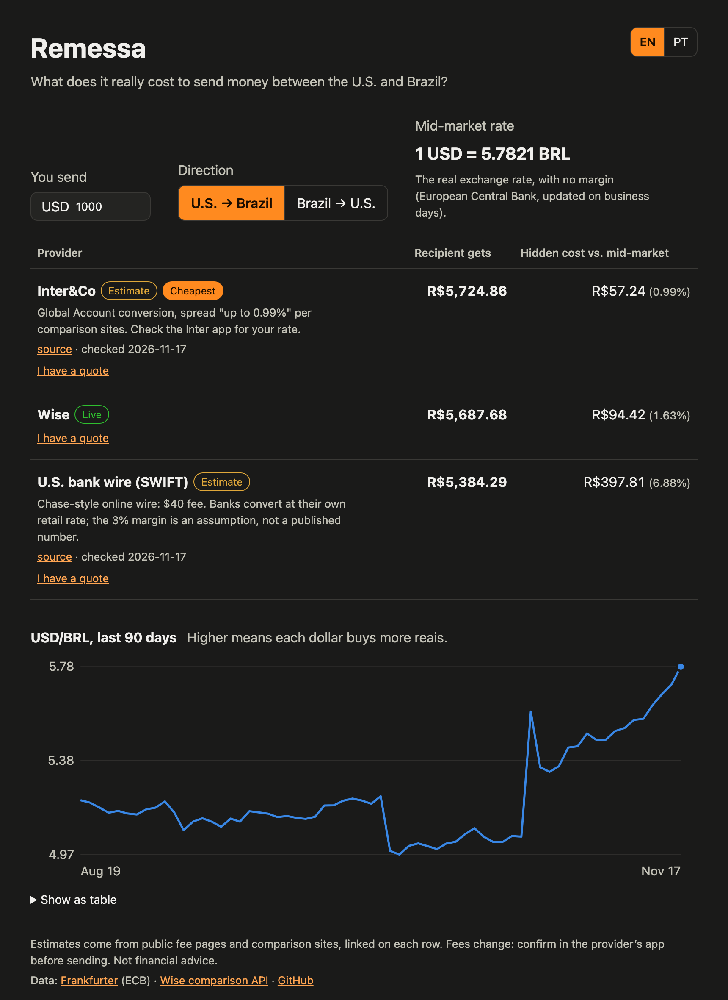

# Remessa

**What does it really cost to send money between the U.S. and Brazil?**

Most transfer services advertise a low fee and hide the rest in the exchange rate. Remessa compares what the recipient actually gets against the **mid-market rate** (the real rate, with no margin) and shows the difference as the *hidden cost*, in both directions, in English or Portuguese.



## What it does

- **Both directions:** U.S. → Brazil (sending money home) and Brazil → U.S.
- **Live data where it exists:** the mid-market rate comes from the European Central Bank (via [Frankfurter](https://frankfurter.dev)), and Wise is quoted live from Wise's public comparison API.
- **Honest estimates where it doesn't:** Inter&Co and bank wires have no public quote API, so their fees live in [`src/providers.ts`](src/providers.ts). Each one is labeled **Estimate** and shows its source link and the date it was checked.
- **Bring your own quote:** "I have a quote" lets you type what a provider's app offered you, and the row is recomputed against the mid-market rate.
- **90-day USD/BRL chart** with a hover crosshair and a table view, so you can see whether now is a good time to send.
- **EN / PT toggle:** it defaults to your browser's language.

## How the cost is computed

```
received   = (amount − fee − tax) × mid-market rate × (1 − margin)
hidden cost = amount × mid-market rate − received
```

- The flat fee and Brazil's IOF tax come out of the amount sent, then the rest converts at the provider's rate.
- Some fees are waived above a threshold (Inter waives its BRL 50 remittance fee from USD 500).
- Live quotes skip the formula: the hidden cost is simply the mid-market value minus what the provider says will arrive.

The engine is a pure module, [`src/quote.ts`](src/quote.ts), with unit tests in [`src/quote.test.ts`](src/quote.test.ts).

## Run it

Requires Node 20 or newer.

```bash
npm install
npm run dev      # http://localhost:5173
npm test         # quote engine unit tests
npm run build    # static site in dist/
```

The build is a static site with no backend. Both APIs allow browser requests, so it deploys as-is to Vercel, Netlify or GitHub Pages.

## Design decisions

- **No backend.** Both data sources are free, keyless and CORS-enabled, so a static site is enough. Nothing to keep running, and nothing to pay for.
- **Estimates are labeled, never hidden.** A comparison tool is only useful if it's honest about which numbers are verified. Every estimate carries its source and check date. Where the source was a guess (a bank's FX margin isn't published), the note says so.
- **Debounced live quotes.** Typing an amount waits 400 ms before calling Wise, and cancels in-flight requests, so it doesn't fire a request per keystroke.
- **No chart library.** The chart is about 100 lines of SVG: one series, gridlines, a snapping crosshair, and an accessible table fallback.

## Limits

| Shortcut | Why it's fine for now | Next step |
|---|---|---|
| Inter and bank fees are hand-entered | No public API; sources are linked | A small scheduled job that re-checks fee pages and opens a PR when they change |
| Mid-market rate is the ECB daily rate | Good enough to measure margins of 1–7% | An intraday source for the live rate |
| Bank wire only covers U.S. → Brazil | Brazilian banks' outbound pricing varies widely | Add 2–3 big Brazilian banks with sourced fees |

## Related

The ledger side of a remittance (double-entry accounting, idempotent transfers, stored exchange rates) is in my other project, [mini-nu](https://github.com/guipiacsek/mini-nu).

*Not financial advice. Fees change, so confirm in the provider's app before sending.*
